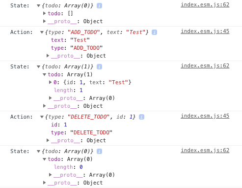

# react-reducer-store
Global state with React hooks and Context API

## Demo app
Demo app uses the live version of react-reducer-store. To run the Demo app.
```
cd demo
yarn start
```
Demo app is hosted in [Github pages](https://vijayst.github.io/react-store/). Apart from normal functionality that you
expect from the app, clicking the Random better should not output the message: "List component is rendering" in the console.
View the console and check if the logs are acceptable to you. The only middleware that is of real use if the redux-logger middleware.
The rest of the middleware don't add value in the new Hooks api.

## Usage
### Combine reducers
Write as many reducers as you want in your React app. Combine all the reducers to a root reducer as follows.
```
import { combineReducers } from 'react-reducer-store';
import todoReducer from './todoReducer';
import randomReducer from './randomReducer';

export default combineReducers({
    todo: todoReducer,
    random: randomReducer
});
```

### Use Store component
Wrap the root component of your project with Store component
```
import { Store } from 'react-reducer-store';
import rootReducer from './rootReducer';

export default function App() {
    return (
        <Store rootReducer={rootReducer}>
            <Form />
            <List />
        </Store>
    );
}
```

### Use useDispatch hook
Use the useDispatch hook to get the dispatch function to root reducer.
```
import { useDispatch } from 'react-reducer-store';

export default function Form(props) {
    const dispatch = useDispatch()

    function handleRandom() {
        dispatch({ type: 'DO_RANDOM' });
    }
```

### Use useStore hook
Use the store from the List component using useStore hook
```
import { useStore, useDispatch } from 'react-reducer-store';

export default function List() {
    const todo = useStore(state => state.todo, []);
    const dispatch = useDispatch();

    function handleDelete(id) {
        dispatch({
            type: 'DELETE_TODO',
            id
        });
    }

    return (
        <div className="list">
            {todo.map(item => (
                <ListItem key={item.id} 
                    onDelete={handleDelete.bind(null, item.id)} 
                    text={item.text} 
                />
            ))}
        </div>
    );
}
```


### Logging
To add logging to the console, set the log prop on the Store to true.
```
<Store rootReducer={rootReducer} log={true}>
  ...
</Store>
```

Output looks like below:



